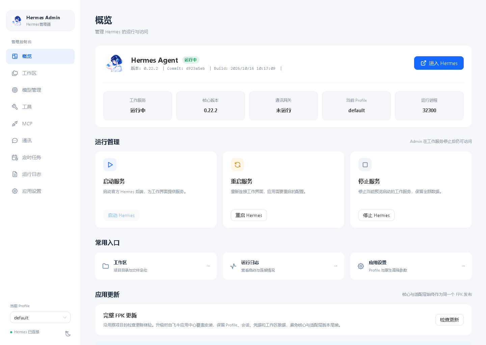
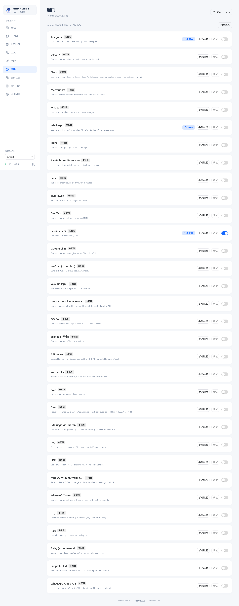
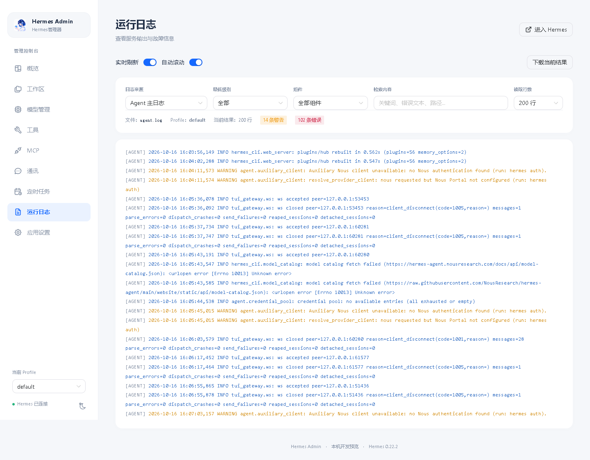
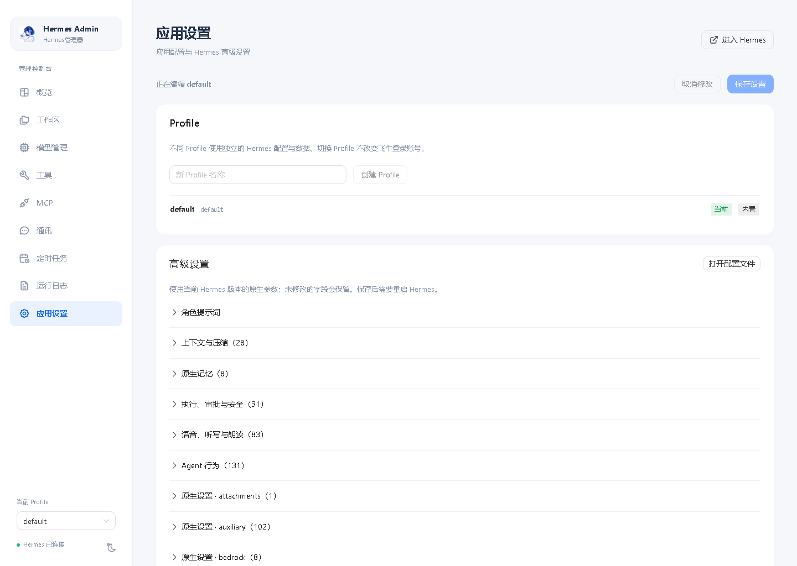
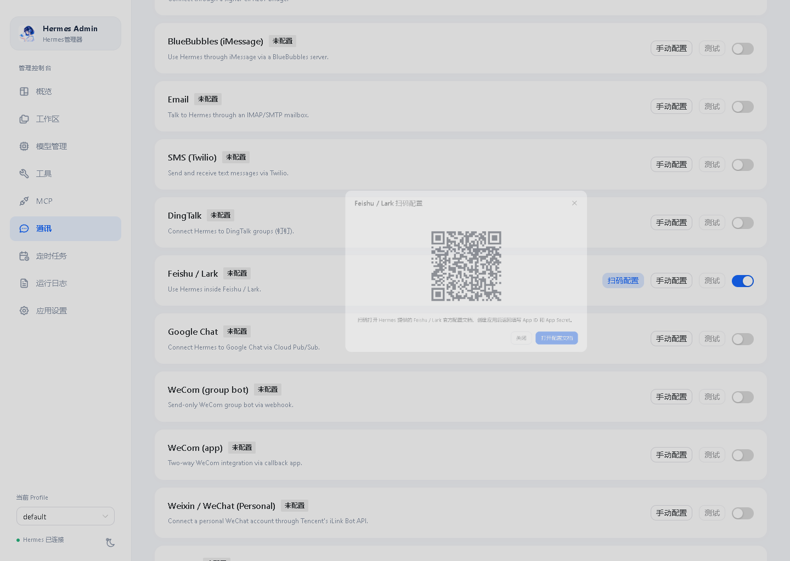
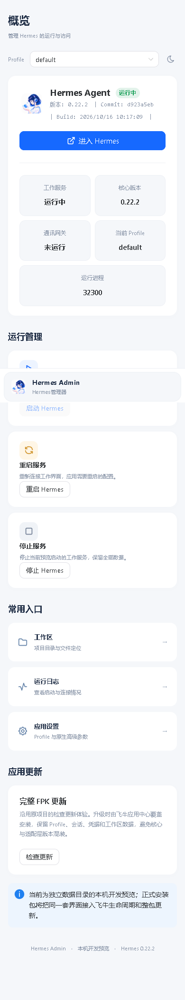
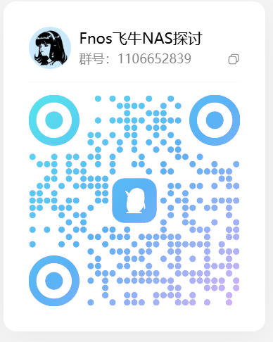

# Hermes Agent for fnOS

<p align="center">
  
</p>

<p align="center">
  <a href="LICENSE"></a>
  
  
  
</p>

**Hermes Agent for fnOS** 把官方 [Hermes Agent](https://github.com/NousResearch/hermes-agent) 完整跑进飞牛 NAS（fnOS）：原生 `.fpk` 一键安装，内置官方核心源码（editable 安装 + 预构建前端），自带 **Hermes Admin 管理面板**与**官方桌面端同款工作界面（浏览器适配）**，支持多模型供应商、多消息平台、定时任务、持久记忆与技能系统。

> **项目来源**：本项目由 [veenyi/fnos-hermes-agent](https://github.com/veenyi/fnos-hermes-agent) 的 fnOS 适配发展而来，现由 **AnyNice** 接手维护并重构。当前应用包 **v0.21.152**，内置官方稳定核心 **Hermes Agent 0.22.2**（tag `v0.22.2`，提交 `d923a5eb`）。核心按官方 tag 与完整提交锁定（`config/bootstrap/hermes-source.json`），应用包版本与核心版本分别管理。

---

## 双入口架构

| 入口 | 定位 | 说明 |
| --- | --- | --- |
| **Hermes Admin**（管理面板） | 生命周期 · 配置 · 运维 | Vue3 管理控制台：概览启停、工作区、模型管理、工具、MCP、通讯、定时任务、运行日志、应用设置 |
| **Hermes 工作界面** | 对话 · 会话 · 任务 | 在飞牛浏览器中复用官方 Windows 桌面端同款界面（桌面渲染器 + 浏览器宿主层适配） |

两个入口共享同一 Profile 与会话数据，不复制会话库；配置管理统一收口在 Admin，工作界面保留日常对话操作。设计说明见 [docs/REDESIGN-DIRECTION.md](docs/REDESIGN-DIRECTION.md)，浏览器适配进度与验收清单见 [docs/BROWSER-ADAPTATION.md](docs/BROWSER-ADAPTATION.md)。

## 功能特性

### Hermes Admin 管理面板
- **概览大屏**：服务状态（核心版本 / Commit / 构建时间）、一键启动 / 重启 / 停止、应用更新检查与 FPK 下载入口
- **工作区**：按 Profile 的原生项目目录定位与文件浏览
- **模型管理**：45 家原生预设供应商搜索配置、自定义 OpenAI 兼容接口、模型发现与设为默认、OAuth 状态
- **工具 / MCP**：原生工具集与技能启停、MCP 服务（HTTP/stdio）新增、启停、测试
- **通讯**：原生平台目录全量接入（微信、企业微信、QQ、飞书/Lark、Telegram、WhatsApp、Discord、Slack、Matrix、钉钉等），平台级启停与真实连接测试；**扫码自动配置**：飞书/Lark（device-code 流程）、微信（iLink 机器人二维码）、QQ（q.qq.com 绑定二维码），密钥仅存服务端会话、不回传浏览器
- **定时任务**：原生 cron 列表、新建、修改、暂停/恢复
- **运行日志**：原生 `/api/logs` 来源/级别/组件筛选 + 宿主与网关进程输出
- **应用设置**：Profile 创建/删除/激活、SOUL 提示词编辑、高级设置（上下文压缩/记忆/执行审批等原生参数，保存后提示重启生效）、打开原始 config.yaml 入口

### 核心能力（由官方 Hermes Agent 提供）
- **多模型供应商**：OpenRouter、OpenAI、Anthropic、Kimi、MiniMax 等 45 家预设 + 自定义接口
- **网页对话**：完整 Markdown 渲染、图片/文件上传分析、会话历史与管理、多会话标签、圆桌讨论
- **持久记忆**：跨会话学习、记忆与知识库沉淀（Obsidian 风格 vault）
- **多消息平台网关**：微信/QQ/飞书/企微/Telegram/WhatsApp 等统一 Channels 网关，通道角色路由
- **技能系统**：内置技能 + 官方技能目录安装、技能市场
- **代码执行**：安全的终端/代码工具集（需显式启用）
- **语音**：本地 STT（faster-whisper 中文识别）+ Edge TTS 中文音色 + 流式语音对话模式

### 运维与更新
- **应用更新**：检查 [AnyNice/fnos-hermes-agent](https://github.com/AnyNice/fnos-hermes-agent) 最新 Release、下载 FPK 经飞牛应用中心覆盖升级（保留 Profile、会话、凭据、工作区数据）
- **双架构通用**：单个 FPK 同时内置 x86_64 / arm64 的 CPython 3.14，装机时按 `uname -m` 自动适配，无需分架构下载
- **看门狗诊断**、网关停止/重启提速、监控令牌鉴权
- **升级保留数据**：应用包升级保留 config.yaml、sessions、skills 等用户数据

## 安装

**环境要求**：飞牛 fnOS（x86_64 / arm64），约 1GB 可用空间；依赖 `nodejs_v24`（安装时自动处理）。

1. 飞牛应用中心添加第三方源，或直接上传 `.fpk` 安装包（Release 资产 / `pkg/` 目录）
2. 等待安装完成，桌面出现应用图标
3. 点击图标打开控制面板（Hermes Admin）
4. 「模型管理」页选择供应商并填入 API Key
5. 「概览」页点击启动，开始对话

核心构建与升级流程见 [CORE-UPGRADE.md](CORE-UPGRADE.md)（官方 tag 锁定 → 源码准备 → 前端构建 → 打包 → 真机验证）。

## 界面预览

### Hermes Admin 管理面板

| 概览大屏 | 通讯（飞书已接入） | 运行日志 |
| :---: | :---: | :---: |
|  |  |  |

| 应用设置 | 飞书扫码自动配置 | 移动端适配 |
| :---: | :---: | :---: |
|  |  |  |

### 官方桌面端同款工作界面（浏览器适配）

把官方 Windows 桌面端（Electron 渲染层）借壳跑进飞牛浏览器，**无需安装桌面软件**，浏览器打开即用官方同款工作界面。

| 特性 | 说明 |
| --- | --- |
| **官方同款界面** | 复用官方桌面端渲染器 + 浏览器宿主层，交互与 Windows 桌面版一致 |
| **对话 / 会话 / 任务** | 日常对话、会话管理、任务过程展示；当前会话内可切换已配置模型 |
| **多模态** | 图片 / 文件上传分析、完整 Markdown 渲染 |
| **持久记忆与技能** | 跨会话学习、知识库沉淀，内置技能 + 官方技能市场 |
| **语音** | 本地 STT（faster-whisper 中文）+ Edge TTS 中文音色 + 流式语音对话 |
| **模型接入向导** | 首装引导，一次点击连接模型提供方（订阅或自带 API Key） |
| **数据共享** | 与 Hermes Admin 共享同一 Profile 与会话数据，不复制会话库 |

<p align="center">
  
</p>

*上图为首次连接模型向导态（「开始设置 Hermes Agent」）：选择 Nous Portal 订阅或自带 API Key 即可开始对话，大多数选项一次点击。*

## 目录结构

```
cmd/                生命周期回调（install/upgrade/uninstall/config）
app/server/         monitor.js（Node 面板/进程管理）+ 浏览器宿主 + WhatsApp bridge
app/ui/             经典 Web 控制台（单文件）
app/admin-ui/       Hermes Admin 管理面板（Vue3 构建产物）
app/work-ui/        官方桌面端工作界面浏览器宿主
frontend/admin/     Hermes Admin 前端源码（Vue3 + Naive UI + Pinia）
app/hermes-src/     官方 Hermes 核心源码（随 FPK 内置，gitignore）
config/             bootstrap（核心版本锁定）+ prompts（SOUL/内置技能）
scripts/            prepare-hermes.py / package-fpk.py / build-browser.mjs
tests/              FPK 打包、安装脚本、核心回归等测试
pkg/                构建产物（.fpk + sha256）
```

## 历史迭代记录

双入口重构（v0.21.150）与核心升级（0.22.x）的记录见 [CHANGELOG_v0.21.150.md](CHANGELOG_v0.21.150.md)、[CHANGELOG_v0.22.1.md](CHANGELOG_v0.22.1.md) 与 [CORE-UPGRADE.md](CORE-UPGRADE.md)。

## QQ 交流群

<p align="center">
  
</p>

---

*核心功能与行为以官方 [Hermes Agent](https://github.com/NousResearch/hermes-agent) 为准；本仓库负责飞牛适配、Hermes Admin 管理面板与浏览器宿主层。*
